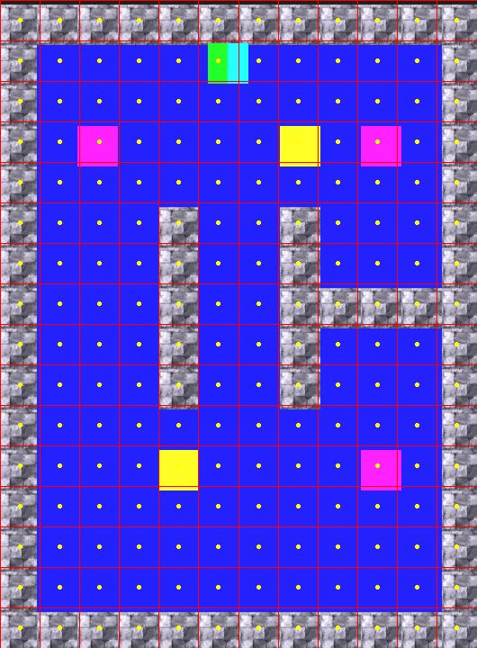
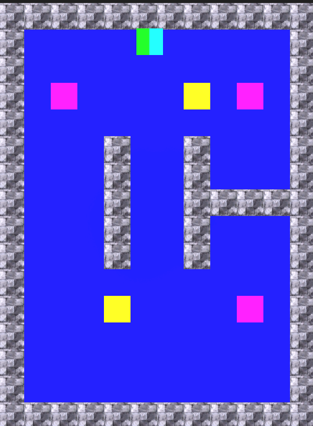
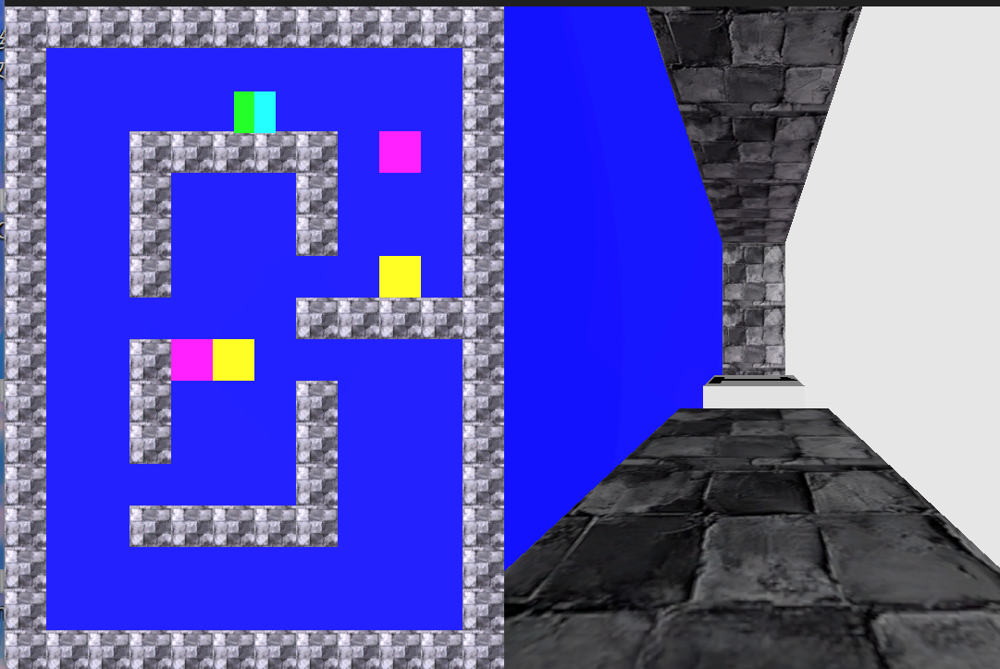

# Smart-Car Grid-Map Vision

Vision firmware for a small autonomous car that drives on a printed grid map. A camera board reads the
map through an image sensor, works out which cell holds what (wall, floor, box, target, bomb), keeps
track of where the car itself is, and answers position requests from the vehicle's main controller over
a serial link.

Everything in this repository was written for one competition vehicle. The camera board is the "eyes" of
that vehicle; the drive train, steering, and path planning live on a separate controller that is **not**
part of this repository (see [My role](#my-role)).

---

## What it actually does

The task is a push-box style puzzle played on a physical mat: the car has to reach targets, push boxes
onto them, and avoid bombs. To plan anything, the controller needs two things that only the camera can
provide:

1. **A map of the current level** - a 12 x 16 grid of characters describing the static scene.
2. **The car's own position** - continuously, in grid coordinates.

The board produces both. Per level it first calibrates the grid geometry on screen, then captures a
one-time wall mask, then keeps tracking the car every frame while re-reading the whole map
periodically. Position and map are sent over UART when the controller asks for them.

The map uses this character set:

| Char | Meaning |
| --- | --- |
| `#` | wall |
| `-` | floor (blue mat, walkable) |
| `$` | box |
| `.` | target / destination |
| `*` | bomb |

The car itself is deliberately **not** written into the map. The map describes the world; the car is a
continuously updated coordinate. Keeping those two things apart was a deliberate design decision (see
[Design notes](#design-notes)) - an earlier version stamped a car marker into the map grid and could
overwrite a wall on the way, which then disappeared from the obstacle list used for position correction.

---

## How the firmware works

`main.py` owns the camera, the grid model, the character map, and the UART protocol.
`tracker.py` owns everything about locating the car inside one frame.

### 1. Grid calibration (once per boot)

The screen geometry of the mat depends on how the camera was mounted, so the grid is measured instead
of assumed. `calibrate_grid()` looks for the **inner edge of the outer wall ring** - the border between
the wall band and the playable area - and derives origin, cell width, and cell height from it.

The search is a scoring problem rather than an edge-detector call:

- Candidate lines are scanned in a window of about 45 px around the fallback geometry
  (`COLS = 16`, `ROWS = 12`, origin `(33, 35)`, cell `16.5 x 15.8` px).
- Each candidate line is sampled along its length; for every sample the 3x3 LAB mean on both sides is
  compared against a dedicated, deliberately loose grey-wall threshold. Wall outside plus floor inside
  scores high, wall outside plus known map content inside scores medium.
- High-scoring positions that sit next to each other are merged into one plateau and replaced by its
  centre, so a several-pixel-wide edge does not turn into two candidate lines.
- Left/right and top/bottom candidates are then paired, and each pair is turned into a cell size. Pairs
  outside 10-24 px per cell, or with a badly non-square aspect ratio, are dropped.
- The surviving rectangle is validated side by side: each of the four sides needs roughly 68% wall
  outside, 50% floor inside, and 75% known content inside, so a long internal wall or clutter across the
  screen border cannot win.
- Five mutually consistent detections are required before the result is accepted; the median of those
  five is used. If the search never converges, the constant fallback geometry stays in use, which keeps
  the board running instead of failing to boot at the venue.

This is a translation-and-scale calibration for an approximately axis-aligned, near-vertical view. It is
not a perspective rectification - see [Limitations](#limitations-and-known-issues).

### 2. Wall mask (once per level)

Walls are static within a level and a missed wall is much more expensive than an extra one, so walls are
captured separately and then frozen:

- Three frames are taken.
- Each cell is checked at five positions (centre plus four offsets of about 18% of a cell).
- A cell is a wall if at least 3 of the 5 positions hit the wall threshold.
- If any of the three frames says "wall", the cell stays a wall for the rest of the level.
- Border cells are always walls.

From that point on, the ordinary per-cell classifier is not allowed to invent new walls. This prevents
the car body, boxes, and specular highlights from being promoted to walls mid-level, at the cost of not
being able to open a new path when a bomb destroys a wall (a deliberate trade-off, documented in
[Design notes](#design-notes)).

### 3. Per-frame car tracking (`tracker.py`)

`CarTracker.update()` runs on every frame and does four things:

- **Search region.** Normally a small window around the averaged recent position (half-size about 2.2
  cells, minimum 24 px). If there is no history yet, or tracking has failed three frames in a row, the
  window expands to the whole playable area so the car can be re-acquired.
- **Blob search.** `find_blobs()` with the main car threshold; if that returns nothing, the same search
  runs again with a darker-corner fallback threshold. Candidates are filtered by size (8-35 px per side
  for a normal one-cell car), aspect ratio (0.6-1.6), and by requiring the centre to sit inside the
  playable area, which excludes anything in the outer wall band or off the mat.
- **Box exclusion.** Boxes are a similar colour to the car under some lighting. The tracker confirms
  boxes only in the 3 x 3 neighbourhood of the last known cell, then removes candidates whose centre
  falls inside a box core (about 0.92 cell square). If the car and a box have merged into one blob, the
  tracker crops the search to the side of the box the car was last seen on, re-runs `find_blobs()` in
  that reduced region, and takes the centre of the real remaining car blob instead of the merged centre.
- **Filtering and coordinates.** Accepted centres go into a 3-sample history; the average drives the
  overlay and the search window. A candidate that jumps more than 1.3 cells is rejected, unless the
  tracker has been failing for five frames, in which case a far candidate must appear twice in a
  consistent position before the old anchor is dropped. Pixel centres are converted to grid coordinates
  with the origin at the bottom-left wall centre, X to the right, Y upwards, and rounded to one decimal
  place of a cell - `rel_x`/`rel_y` are those tenths as integers.

Coordinates are pushed out of walls only when the car centre would geometrically overlap a wall cell.
The car is modelled as 0.98 cell square, the correction is capped at 0.1 cell per update, and only the
smallest well-defined push is applied, so a corner does not get two stacked corrections.

### 4. Character map (every 30 frames)

`process_once()` walks all 192 cells, reads the 3x3 LAB mean at each cell centre, and classifies it in a
fixed priority order: target, box, bomb, wall, floor. Anything that matches nothing becomes floor, which
is a deliberate anti-deadlock fallback rather than an accurate "unknown" report.

Two rules keep the map stable:

- A cell is only a wall if the level's wall mask says so. An observed wall that is not in the mask is
  re-classified with walls disabled.
- The cell the car currently occupies never overwrites the underlying content; it keeps whatever the
  previous map had, or floor if there was nothing.

While waiting for the next level the map is read every 3 frames instead of every 30, and only that
observed result is used to decide whether a new level has appeared.

### 5. Level transitions

A level counts as cleared when the interior of the observed map is strictly empty twice in a row (the
car's own cell is excluded). The board then waits for new content: the interior shows at least one
non-floor cell in two consecutive scans. At that moment the wall mask is captured again, the map is read
once, and the tracker's history is cleared so the previous level's last position cannot drag the new
level's search window. Grid calibration and thresholds are intentionally **not** redone - the camera has
not moved between levels.

---

## Serial interface

The board is a peripheral. It never drives the car; it answers. Nothing is sent unless the controller
asks, and human-readable logging goes to the debug terminal, not to the UART.

Request bytes:

| Request | Reply |
| --- | --- |
| `1` | map + position |
| `2` | position only |

Map + position frame:

```
0xAA  <192 ASCII characters, row-major, 12 rows x 16 columns>  \r\n  0xFF
<position line>\n
```

Position line format: `X<n>Y<n>`, where both numbers are grid coordinates multiplied by 10 and rounded
to an integer. `X15Y23` therefore means x = 1.5 cells, y = 2.3 cells, measured from the bottom-left
interior corner. When the car cannot be located the line is exactly `LOST`.

On a request the board does not answer from the last computed frame. It immediately takes three fresh
frames, runs the tracker on each, and pads to a 200 ms window before replying, so the reported centre is
an average of recent successful detections rather than a single noisy frame. If all three fresh frames
fail, the reply is `LOST` - the board does not recycle an old position as if it were current, so the
controller can decide to skip that update.

---

## My role

This repository is my own work inside a team project, and only my part is here. I was responsible for
the vision and localisation chain end to end:

- the camera-side firmware (`main.py`, `tracker.py`): grid calibration, wall-mask capture, LAB
  classification, the character map, the car tracker, the UART protocol, and the on-screen debug overlay;
- the threshold calibration work behind those LAB ranges, done by sweeping exposure and sampling the map
  under the lighting it was tuned for (the sweep tool is in `tools/`);
- the desktop helpers used to turn map screenshots into character maps and to generate and validate
  solvable practice levels (`tools/`);
- the regression tests in `tests/`.

The chassis, motor control, steering, path planning, and the puzzle-solving logic on the main controller
were other team members' work and are not included here. Nothing in this repository is a shared
team codebase; no teammate's code was copied in.

---

## Repository structure

```
.
|-- main.py                     board firmware: camera, grid, map, UART, level state machine
|-- tracker.py                  car blob tracking, filtering, pixel -> grid coordinates
|-- requirements.txt            desktop-side Python dependencies
|-- docs/
|   |-- algorithm-notes.md      detailed notes on the algorithms, parameters, and failure modes
|   |-- example-character-map.txt   a captured 12 x 16 map in the wire format, from an earlier tool build
|   `-- images/                 screenshots used to validate the map-extraction pipeline
|-- tests/
|   |-- test_grid_calibration.py    grid detection and consensus logic, on synthetic frames
|   |-- test_tracker_split.py       tracker candidate filtering and recovery, with fake blobs
|   `-- maps/                   reference character maps used for manual visual checks
`-- tools/
    |-- detect_map.py           desktop: watch a folder of screenshots, write character maps
    |-- crop_map.py             desktop: read one cropped map image and print its character map
    |-- exposure_capture_test.py  board: exposure sweep and photo capture for threshold tuning
    `-- sokoban_generator.html  offline level generator with a solvability checker
```

---

## Running it

### Board side

`main.py` and `tracker.py` are MicroPython for an OpenMV-style camera board. They are **not** importable
on a normal desktop interpreter: `main.py` imports `sensor` and `machine.UART`, which only exist in the
board firmware.

1. Copy `main.py` and `tracker.py` to the board's filesystem, side by side, so `from tracker import
   CarTracker` resolves.
2. Wire the board's UART to the vehicle controller. `main.py` opens the UART at 115200 baud; adjust the
   interface and pins there to match your wiring.
3. Power the board with the mat in view and let it run. On boot it waits about 2 s for auto-exposure to
   settle, then calibrates. Debug output appears on the IDE terminal: the calibrated geometry, the
   recognised map whenever it changes, and the current position.
4. Keep the board on the default auto exposure. `main.py` does not lock exposure - an earlier version
   did, and was dropped because the daily thresholds were tuned for auto exposure instead.

The overlay drawn on the preview is: white crosses at cell centres, a red rectangle on the tracked car,
and a red frame marking the inner map border. Drawing happens after all measurements on that frame, so
the overlay cannot contaminate the colour sampling.

### Desktop helpers

```bash
python -m pip install -r requirements.txt
```

`tools/detect_map.py` is the batch tool used during development: it polls `input/`, crops a fixed
540 x 720 region from each screenshot, samples the centre of every cell, classifies by RGB rules, and
writes a 12 x 16 character map to `output/<name>.txt`. It creates both folders on start; drop images in
and it picks them up within a second. Both paths are relative, so run it from inside `tools/`. The crop
window and the RGB rules are tuned to the reference screenshots used during development, so
treat them as a starting point rather than a general screenshot reader - in particular, see the note
about lattice orientation under known issues.

`tools/crop_map.py` reads a single cropped map image, samples it on a 16-row by 12-column lattice, and
prints the result. It has a hard-coded input file name, so run it in a folder that contains
`map_crop.png`.

Both desktop tools need Pillow. They do not talk to the board and are not part of the runtime path.

`tools/sokoban_generator.html` opens in any browser and needs no server. It generates levels from a
seed, builds them by running the puzzle backwards from the solved state so solvability is likely,
places bombs away from boxes and targets, verifies solvability with a bounded state search, and exports
either a newline 12 x 16 map or the flat 192-character string the firmware sends. Its interface is in
Chinese.

### Tests

```bash
python -m unittest discover -s tests -v
```

The calibration tests do not import `main.py` (that would need the board firmware). They parse it with
`ast`, execute only the constant and function definitions, and drive `detect_grid_once()` with synthetic
frames, which is why calibration logic can be tested on a desktop at all. The tracker tests use fake
image and blob objects. All 17 tests pass.

---

## Images



**Grid and sampling points.** A development overlay drawn on a cropped map: red lines mark cell
boundaries, yellow dots mark the single point read for each cell - 12 across, 16 down, 192 points in
total. The firmware samples the same way, with a 3x3 LAB mean at each cell centre plus four offset
samples when the wall mask is being captured. A sample point that lands on the wrong side of a real
boundary is exactly what grid calibration exists to prevent.



**The map region as the extractor sees it.** Grey tiled cells are walls, blue is floor, the green/cyan
block is the car, magenta blocks are boxes, yellow blocks are targets. This is the crop that
`tools/detect_map.py` takes from a screenshot before sampling cell centres.



**Where the screenshots come from.** The map panel on the left and the rendered scene on the right are
the same level; the tooling was developed against these captures because a full-screen capture is easier
to iterate on than a live camera feed. These are development captures, not frames from the board camera.

---

## Design notes

**Why the map and the car position are separate.** The map is slow-moving and describes the world; the
position changes every frame and must be fresh. Running them at different rates (map every 30 frames,
tracker every frame) keeps the position responsive. An earlier version wrote the car into the map grid,
and when the tracked cell drifted onto an internal wall the wall character was overwritten - which then
removed that wall from the obstacle list used for position correction. Removing the car from the map
fixed that whole class of bugs.

**Why walls are captured once per level.** The wall band, the box colour, and the car body overlap under
some lighting. Freezing the walls after a dedicated three-frame capture makes the wall set consistent
within a level. The cost is that a bomb destroying a wall cannot open a path mid-level; if that becomes
required, the right fix is a one-way rule (walls may only disappear), not re-enabling wall creation
during normal classification.

**Thresholds.** All colour work is in LAB. The values currently in the firmware:

| Element | L | a | b |
| --- | --- | --- | --- |
| target `.` | 35 to 65 | 58 to 99 | -91 to -38 |
| box `$` | 0 to 100 | -38 to 4 | 45 to 122 |
| bomb `*` | 30 to 75 | 32 to 127 | -47 to 127 |
| wall `#` | 37 to 100 | -5 to 28 | -60 to -4 |
| floor `-` | 28 to 55 | -59 to 88 | -120 to -70 |
| car (main) | 0 to 95 | -128 to -10 | -69 to 69 |
| car (dark-corner fallback) | 0 to 95 | -76 to -11 | -65 to 60 |
| wall during calibration only | 15 to 100 | -13 to 59 | -62 to 4 |

These are the result of empirical tuning under the venue lighting, not a derivation. They will need
re-tuning for a different mat, different lamps, or a different camera. Overlapping ranges are resolved by
classification order, not by confidence, so widening one range can silently steal cells from another.

**Performance.** At QVGA with one local `find_blobs()` per frame the tracker is not the bottleneck; the
expensive parts are the second `find_blobs()` triggered by the fallback threshold, a fallback to
whole-area search, and the 192-cell map sweep. That is why the map runs every 30 frames.

More detail, including the measured reasoning behind each parameter, is in
[docs/algorithm-notes.md](docs/algorithm-notes.md).

---

## Limitations and known issues

- **Mounting tolerance, not free placement.** Calibration searches only about 45 px around the fallback
  geometry and assumes an axis-aligned, near-vertical view of the mat. It tolerates small shifts and
  scale changes after the camera is re-seated; it does not handle a strongly oblique view, rotation, or
  a mat placed anywhere on screen.
- **Thresholds are lighting-specific.** There is no runtime adaptation. Changing the venue lighting
  means re-tuning the table above.
- **Walls cannot be destroyed mid-level.** Intentional, described in the design notes.
- **The tracker does not use the wall map.** It excludes boxes and off-mat regions, but an internal wall
  patch that happens to match the car threshold is still a valid candidate. When the car hugs an
  internal wall, the merged blob can pull the reported centre toward the wall. This is the most
  significant known weakness of the current tracking code.
- **Position correction is one-sided.** If the tracked centre has already crossed a wall centre, the
  correction determines the push direction from that (already wrong) position and may push it out on the
  wrong side. There is no "last trusted side" memory.
- **`LOST` is honest but coarse.** It carries no age or confidence, so the controller cannot distinguish
  one bad frame from a sustained loss.
- **Unknown cells become floor.** The classifier's final fallback is floor, which avoids deadlocks but
  can silently erase a weakly-lit object instead of reporting it.
- **Two assertions were replaced with invariants.** `test_merged_blob_returns_real_side_blob_center` and
  `test_square_blob_touching_box_core_also_recovers` used to require exactly two `find_blobs()` calls,
  but box-side recovery now searches one region per allowed strip run, so the count follows the grid
  geometry. They now assert that a side search happened and that no side region contains the box centre.
  `test_above_box_crops_at_box_top` allows one pixel of slack, because ROI bounds are rounded outward by
  half a pixel. All 17 tests pass; behaviour was not changed.
- **`tools/crop_map.py` hard-codes its input file name** (`map_crop.png`) and must be run from a folder
  that contains it.
- **The two desktop tools disagree about lattice orientation, and neither matches the screenshots.**
  Measured on the development screenshots, the map panel is 12 cells across and 16 cells down, with a
  pitch of about 44-45 px. `tools/crop_map.py` uses 16 rows by 12 columns, which is the right shape for
  that panel; `tools/detect_map.py` divides the same region into 16 columns by 12 rows, so its sample
  points miss the real cell centres - running it on one of the screenshots produces a map with a
  staircase of spurious walls. The firmware uses a 16-column by 12-row grid on a QVGA frame. The
  screenshots are therefore not a drop-in source for firmware-format maps, and this inconsistency was
  not resolved while packaging the repository.
- **`docs/example-character-map.txt` is not reproducible from the current tools.** It is a 12-row by
  16-column map in the firmware's wire format, captured from an earlier build of the screenshot pipeline
  which marked unknown cells with `?` - a character the current `detect_map.py` never emits (it falls
  back to floor instead).
- **`tests/maps/*.txt` are not loaded by any test.** They are reference maps for manual visual checks
  of the classifier. The current automated tests cover calibration and tracker filtering only.
- **No hardware notes beyond the code.** Pin assignments, motor wiring, and the controller-side protocol
  handling live with the vehicle project, not in this repository.

---

## What is not in this repository

- The vehicle's main controller firmware, motor and steering control, and path planning.
- The puzzle-solving and decision logic that consumes the map and position.
- Historical backups and the chronological development log of the vision code.
- The separate photo-organisation utility that lived in the same working folder; it is unrelated to this
  project.
- Any team, event, or institution identifying information. Hardware model names appear only where they
  are needed to explain a firmware quirk.
